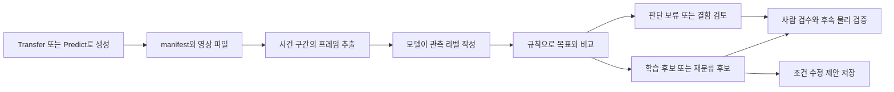

# 생성 영상의 의미를 다시 확인하는 실습 안내서

관련 원리와 코드 구조는 [이론 설명서](THEORY.md)와 [기술 구조 설명서](TECHNICAL_DESIGN.md)를, 새 조건 추가는 [작성 안내](CRITERIA_AUTHORING.md)를 참고하세요.

이 독립 프로젝트의 설치 순서는 [첫 화면 안내](../../README.md)를 참고하세요. 기존 AV 3.0 저장소를 함께 설치하지 않아도 CPU 실습을 실행할 수 있습니다.

이 실습은 **“생성할 때 요청한 장면”과 “완성된 영상에서 실제로 보이는 장면”을 따로 기록**합니다. 예를 들어 “비 오는 밤에 차량이 끼어드는 영상”을 요청했더라도, 결과 영상에는 비와 야간 조명만 있고 끼어드는 과정은 없을 수 있습니다. 이때 원래 생성 목표를 지우지 않고, 관측 라벨과 불일치 항목을 함께 남깁니다.

처음에는 [S1 노트북](../../notebooks/S1_Semantic_Video_Verification.ipynb)을 위에서 아래로 실행하세요. CPU 예제는 외부 모델이나 영상 파일 없이 동작합니다. 실제 영상을 분석하는 부분은 별도 설정을 마친 뒤 켜도록 되어 있습니다. 판별 조건의 상세 정의는 [권장 판별 기준](SEMANTIC_CRITERIA.md), 이번에 실제로 실행한 범위는 [검증 기록](SEMANTIC_VALIDATION.md)을 참고하세요.

## 1. 기존 파이프라인에서 어디에 붙이나요?



마지막 화살표는 자동 재생성 실행이 아닙니다. 수정 제안을 사람이 검토한 뒤 기존 생성 노트북에 반영하고, 새 결과도 S1에서 다시 판정합니다. 현재 코드는 영상의 화질을 바꾸거나 픽셀을 편집하지 않습니다. 의미 라벨을 정돈하고, 어떤 부분을 다시 만들어야 할지 알려 주는 단계입니다.

기존 AV 3.0 로컬 저장소에서는 **M4가 Transfer, M5가 Predict**입니다. 확인한 원격 저장소의 개편 버전에서는 **M5가 Transfer, M6가 Predict**입니다. S1은 모듈 번호가 아니라 manifest의 `condition`, `scenario`, `generated_video`를 읽으므로 두 구성을 지원합니다. 기존 노트북의 파일 존재·크기 검사는 필요하지만, 그것만으로 요청한 사건이 영상에 들어갔는지는 알 수 없습니다.

## 2. 이번에 추가한 파일

| 파일 | 역할 |
|---|---|
| [S1 노트북](../../notebooks/S1_Semantic_Video_Verification.ipynb) | 개념 설명, CPU 실행 예제, 실제 영상 연결, 검수와 평가 |
| [criteria.ko.json](../../src/av_decision/configs/criteria.ko.json) | 한국어 질문, 선택지, 임계값, 생성 목표 이름의 명시적 대응표 |
| [semantic.py](../../src/av_decision/semantic.py) | 입력 변환, 응답 검증, 판정 분기, 검수 파일, 평가 |
| [semantic_providers.py](../../src/av_decision/semantic_providers.py) | 시간순 프레임 추출, 로컬 Valen 및 Cosmos HTTP 연결 |
| [semantic_cli.py](../../src/av_decision/semantic_cli.py) | 노트북과 같은 함수를 사용하는 명령행 실행 |
| [pyproject.toml](../../pyproject.toml) | 실제 영상 디코딩에 필요한 선택 패키지 |
| [test_semantic.py](../../tests/test_semantic.py) | 시간축·실패 보존·판정 의미·모델 입력 계약 테스트 |

노트북은 로직을 별도로 복사해 두지 않고 `av_decision` 모듈을 가져옵니다. 따라서 기준이나 코드를 바꾸면 노트북과 명령행에 같은 변경이 적용됩니다. 모듈을 수정한 뒤에는 Jupyter 커널을 재시작하고 전체 셀을 다시 실행하세요.

## 3. CPU로 먼저 실행하기

Python 3.10 이상이 필요합니다. Decision 폴더에서 먼저 `python -m pip install -e .`로 설치한 뒤 실행하세요. 명령행 CPU 판정 로직은 표준 라이브러리만 사용합니다. Jupyter 화면은 별도 Jupyter 환경이 필요합니다.

```bash
python3 -m av_decision.semantic_cli demo --out .study-runs/semantic-demo-001
python3 -m unittest discover -s tests -v
```

첫 명령은 **영상 추론을 하지 않습니다.** 미리 작성한 여섯 가지 가상 관측값을 넣어서 분기 규칙을 확인합니다. 예상 결과는 학습 후보 2개, 재분류 후보 1개, 보류 2개, 결함 격리 1개입니다. 예제의 확률 0.94도 설명을 위해 만든 숫자입니다. 모델의 정확도나 속도로 인용하면 안 됩니다.

같은 출력 폴더를 다시 사용하면 오류가 납니다. 실행 이름을 `semantic-demo-002`처럼 바꾸세요. 이전 실험을 조용히 덮어쓰지 않기 위한 동작입니다.

## 4. 실제 생성 결과를 입력으로 바꾸기

Transfer/Predict 출력 폴더에 있는 `manifest.json`과 생성 MP4가 필요합니다. S3에만 있다면 먼저 해당 출력 폴더를 로컬 또는 GPU 서버로 내려받으세요. 이 코드가 AWS 접속이나 다운로드를 자동으로 수행하지는 않습니다. 생성 당시의 폴더 구조, 특히 Predict의 하위 폴더를 유지하세요.

아래 경로는 예시입니다. 자신의 환경에 맞게 바꿔서 실행합니다.

```bash
python3 -m av_decision.semantic_cli import-manifest \
  --manifest /data/cosmos-run/manifest.json \
  --video-root /data/cosmos-run \
  --source-group nuscenes-log-001 \
  --split train \
  --out /data/review-input/records.json
```

`--source-group`에는 생성 작업 번호가 아니라 **원본 주행을 식별하는 값**을 넣으세요. 같은 주행에서 만든 원본·우천·안개·야간 변형은 모두 같은 그룹이어야 합니다. 여러 원본 주행이 섞인 manifest라면 변환한 records를 각 원본별로 고쳐야 합니다. 기본 예제처럼 같은 원본에서 여러 조건을 만들었다면 한 그룹을 그대로 사용해도 됩니다.

변환한 JSON 한 행은 다음 구조입니다. 수치와 경로는 형식을 보여 주기 위한 예시입니다.

```json
{
  "clip_id": "drive-001-rain-cut-in-01",
  "video_path": "/data/cosmos-run/generated.mp4",
  "source_group": "nuscenes-log-001",
  "split": "train",
  "target": {"weather": "rain", "cut_in": "yes"},
  "target_needs_review": false,
  "source_observation_hz": null,
  "window": {"start_s": 0.0, "end_s": 5.0},
  "attempt": 1
}
```

| 필드 | 무엇을 확인하나요? |
|---|---|
| `clip_id` | 배치 안에서 중복되지 않는 영상/구간 ID입니다. 한 영상의 여러 구간도 다른 ID를 씁니다. |
| `target` | 생성할 때 의도한 조건입니다. 모델이 쓴 관측 결과로 덮어쓰지 않습니다. |
| `target_needs_review` | 알려지지 않은 목표 이름은 `true`로 나옵니다. 목표를 직접 검토·정의한 다음 `false`로 바꿉니다. |
| `source_observation_hz` | 독립적인 관측의 시간 해상도입니다. 파일의 인코딩 fps를 그대로 넣지 마세요. 근거가 없으면 `null`로 두며, 시간 관련 판정은 보류됩니다. |
| `window` | 사건 전후를 포함한 구간입니다. 초 단위이며 끝 시각은 포함하지 않습니다. 긴 영상을 자동으로 드문드문 줄이지 않습니다. |
| `split` | `train`, `validation`, `test`, `unassigned`입니다. 아직 정하지 않았다면 마지막 값을 사용합니다. |
| `attempt` | 현재 결과까지 생성한 횟수입니다. 새로 생성했다면 1을 더합니다. |

기존 M1의 2Hz 키프레임을 10fps MP4로 저장했다면 새로운 실제 관측이 생긴 것은 아닙니다. 원본 관측 주기는 2Hz입니다. 생성 모델이 중간 움직임을 그렸더라도 그것이 원본의 실제 움직임을 입증하지는 않습니다. 생성물의 시각적 연속성을 연구하는 평가와 원본 사건의 사실성을 확인하는 평가는 구분하세요. 이 실습의 기본 판정은 확인되지 않은 시간 정보를 보수적으로 보류합니다.

`near_collision`과 `sudden_brake`는 자동 목표 매핑에서 제외했습니다. 간격이 좁아지는 장면을 충돌 직전의 정답으로, 제동등이 켜진 장면을 급제동의 정답으로 바꾸지 않기 위해서입니다. “간격 감소의 시각적 단서”만 조사하려면 목적을 명시적으로 바꾸어 `gap_closing=yes`를 넣을 수 있습니다. 이 경우에도 `near_collision`이 검증되었다고 기록해서는 안 됩니다.

## 5. 모델 연결 방식과 기술적 선택

GPU용 PyTorch 설치부터 실행하려면 [GPU 실행 안내](GPU_GUIDE.md)를 먼저 읽으세요. 아래 설명은 모델 파일과 실행 환경이 준비되었다는 전제로 연결 방식을 다룹니다.

모델 선택을 JSON 파일로 관리하려면 [모델 설정과 교체](MODEL_CONFIGURATION.md)를 참고하세요. `--provider-config`와 노트북의 `PROVIDER_CONFIG`가 같은 설정을 읽습니다. 기존의 개별 옵션 실행도 유지하며, 다른 호환 VLM 서버는 `--provider vlm-http`로 연결할 수 있습니다.

| 경로 | 입력·출력 | 이번 구현에서 맡는 역할 |
|---|---|---|
| CPU Fixture | 미리 만든 선택지와 확률 | 규칙·보고서·검수 흐름을 학습합니다. 영상 모델이 아닙니다. |
| 로컬 Valen | 시간순 이미지와 선택형 질문 → 선택지별 확률 | 한정된 기준으로 재분류할 후보 모델입니다. 실제 성능은 별도 측정합니다. |
| Cosmos Reason 호환 HTTP 서버 | 같은 시간순 이미지와 질문 → JSON 선택지 | 다른 모델과 판단을 비교하거나 사람이 재검토할 자료를 만듭니다. |

두 실제 경로는 같은 샘플링 함수를 사용합니다. 기본은 초당 4장, 최대 8초, 최대 32장이고, 실제 영상 타임스탬프(PTS)를 따라 프레임을 고릅니다. 각 프레임 앞에 시각을 붙이며, 이미지의 긴 변/짧은 변은 960×540 경계 안에 들어오도록 비율을 유지해 줄입니다. 작은 객체를 판단해야 하면 해상도·구간 설계를 다시 검증하세요.

이 방식은 **여러 이미지를 시간순으로 넣는 비교 경로**입니다. 모델별 네이티브 비디오 입력 성능이나 공식 벤치마크를 재현하는 구현은 아닙니다. 기본 4fps가 모든 사건에 충분한 것도 아닙니다. 빠른 사건은 관측 주기와 프레임 수를 늘리고 실제 검수 결과로 확인해야 합니다.

### Valen을 실행하려면

Valen 전용 Python 환경에 공식 모델 카드에서 요구하는 PyTorch·Transformers 및 관련 패키지를 준비합니다. 기존 Cosmos 생성 환경에 한꺼번에 업그레이드하지 않는 편이 좋습니다. 영상 처리를 위한 추가 패키지는 다음 파일로 설치할 수 있습니다.

```bash
python -m pip install -e '.[video]'
```

검토한 모델 snapshot을 로컬에 준비한 뒤 실행합니다. 아래의 revision 자리에는 실제 반입한 모델 commit을 넣으세요. 코드가 사용자가 적은 revision과 폴더의 파일을 자동 대조하지는 않으므로 모델 관리 기록도 보관해야 합니다.

```bash
python -m av_decision.semantic_cli run \
  --records /data/review-input/records.json \
  --provider valen \
  --model-dir /models/Valen-2B-reviewed-snapshot \
  --revision ACTUAL_MODEL_COMMIT \
  --sample-fps 4 --max-frames 32 \
  --out /data/review-output/valen-001
```

어댑터는 `AutoModel.from_pretrained(..., local_files_only=True, trust_remote_code=True, dtype="auto", attn_implementation="sdpa")`로 로드합니다. 모델 폴더의 사용자 정의 코드가 실행되므로 반입한 코드를 먼저 확인해야 합니다. 가중치를 일괄 BF16으로 바꾸지 않고, 모델이 정의한 정밀도 경로를 따릅니다. `predict(request, execution="shared_state")`에 공통 질문들을 보냅니다. 설치한 snapshot의 API가 바뀌었다면 이 호출과 응답 형식을 먼저 점검하세요.

질문 ID는 `weather` 등의 고정 키이고, 각 질문에는 `type="choice"`, 한국어 `instructions`, `criteria`가 있습니다. 모델 응답은 모든 질문의 `choice`와 선택지별 `probabilities`를 포함해야 합니다. 확률 합, 누락, 정의되지 않은 선택지, NaN, 최대 확률과 선택한 답의 모순을 검사합니다. 모델 점수가 높다고 실제 정확도가 같은 숫자라는 뜻은 아닙니다. 보고서의 `observed.confidence`는 선택한 답의 확률로 다시 계산한 값이며, Valen 원본 응답의 별도 `confidence` 공식과는 다릅니다. 원본 응답은 raw 파일에 남습니다.

### Cosmos 서버를 실행하려면

멀티이미지 입력을 지원하는 OpenAI 호환 서버를 별도로 준비합니다. 모델에 따라 서버 템플릿과 출력 설정이 다르므로, 먼저 짧은 입력으로 JSON 응답을 확인하세요. 기존 M2의 단일 이미지 캡션 셀을 그대로 시간 사건 판별기로 사용하지 않습니다.

```bash
python -m av_decision.semantic_cli run \
  --records /data/review-input/records.json \
  --provider cosmos-http \
  --endpoint http://127.0.0.1:8000/v1 \
  --model SERVED_MODEL_NAME \
  --revision ACTUAL_MODEL_COMMIT \
  --out /data/review-output/cosmos-001
```

필요한 인증키는 `SEMANTIC_VLM_API_KEY` 환경변수로 전달합니다. 노트북 코드나 출력에 키를 붙이지 마세요. 이미지 자체를 지정 서버에 보내므로, 실제 데이터 사용이 허용된 서버 주소를 설정합니다.

서버에는 다음 형식을 요청합니다. 실제 응답에는 여덟 질문이 모두 있어야 합니다.

```json
{"answers": {"weather": {"choice": "rain"}, "lighting": {"choice": "night"}}}
```

위 JSON은 형식 설명을 위해 두 항목만 보인 것입니다. 코드 블록이나 긴 추론 설명이 섞인 응답은 형식 오류로 남깁니다. 자유 생성 모델이 적어 준 “확신도 0.95”는 확률로 사용하지 않습니다. 이 경로에서는 선택지만 보관하고 확률을 `null`로 두므로, 현재 규칙상 모든 결과가 사람 검수 대상입니다. Cosmos 응답을 자동 통과시키려면 별도로 검증한 점수 체계가 필요하며, 이번 코드에는 포함하지 않았습니다.

## 6. 판정은 어떻게 진행되나요?

1. 생성 목표·분할·원본 정보를 검증합니다.
2. 원본 파일명이나 생성 프롬프트를 전달하지 않고 모든 영상에 같은 질문을 보냅니다.
3. 응답이 정해진 형식인지 검사합니다.
4. 목표와 상황 폴더에 지정한 기준을 검사합니다. 공통 품질 검사는 영상의 `continuity`, `visibility`, 정지 이미지의 `visibility`입니다.
5. 불확실성, 시간 해상도, 목표 불일치를 구분하여 결과를 기록합니다.

| 결과 | 의미 | 다음 행동 |
|---|---|---|
| `candidate` | 검사한 기준에서 목표와 관측이 일치하는 학습 후보 | 사람이 라벨을 확인하고 학습 데이터 편입 여부를 결정합니다. |
| `relabel_candidate` | 관측은 비교적 명확하지만 목표와 다릅니다. | 관측 기준으로 라벨을 고치거나 수정 제안을 검토합니다. |
| `review` | 근거·시간 정보·점수가 부족하거나 처리에 실패했습니다. | 원본과 추출 프레임, 오류를 확인합니다. 실패도 결과 수에 포함합니다. |
| `quarantine` | 현재 기준에서 명백한 생성 결함이 관측되었습니다. | 삭제하지 않고 별도로 보존하여 검토합니다. |

불확실성이 있으면 결함 판정보다 `review`를 우선합니다. 결함 선택지는 `observed`에 남으므로 사람이 확인할 수 있습니다. `candidate`도 `requires_human_approval=true`입니다. 이 값은 실제 승인 절차를 대신 실행하지 않으며, 승인 기록을 별도로 남기라는 표시입니다.

`observed`에는 여덟 기준의 답이 모두 들어가지만, 통과 조건으로 사용한 항목은 `checked_criteria`에 따로 적습니다. 목표에 없던 다른 사건의 라벨까지 검증이 끝났다고 해석하지 마세요. 학습에 쓸 추가 라벨은 해당 기준으로 검수·평가한 뒤 사용합니다.

## 7. 결과 파일과 사람 검수

| 산출물 | 내용 |
|---|---|
| `records.json` | 이번 실행에서 사용한 입력의 복사본 |
| `report.json` | 분기 수, 관측 라벨, 비교 결과, 보류 이유, 모델·기준 버전, 영상별 소요 시간 |
| `raw-0000.json` 등 | 정상적으로 받은 모델 응답. 형식 오류 응답은 저장 여부가 실패 지점에 따라 다릅니다. |
| `evidence-0000/` 등 | 실제 영상에서 추출한 JPEG, 시각 목록, 파일 해시, 샘플링 조건. CPU 예제에는 없습니다. |
| `human_review.csv` | 사람 정답을 작성하는 양식. 처리 실패 영상도 빈 모델 답과 오류를 포함합니다. |
| `regeneration_plans.json` | 재생성 실행 전 검토할 목표별 수정 제안 |

`human_review.csv`를 복사해서 `human_choice`, `reviewer`, `note`를 채우세요. 정답에는 기준 파일의 선택지 ID를 씁니다. 가능하면 사람은 모델 답을 보기 전에 원본 영상을 보고 먼저 판정하고, 나중에 불일치를 비교하세요. 두 사람이 독립적으로 검수한 뒤 의견이 다른 항목을 함께 확인하면 기준의 애매함을 발견하기 좋습니다.

노트북은 검수 파일을 읽어 기준별 정확도와 이진 사건의 오탐·미탐을 계산하는 예제를 제공합니다. 비어 있는 사람 정답은 평가 대상에서 제외하되, 검수 완료율도 함께 보고해야 합니다. `unknown`과 처리 실패를 성공 사례에서 몰래 빼면 모델 성능이 좋아 보이므로, 양성 정답에서 판단하지 못한 수를 별도로 집계합니다.

`elapsed_s`에는 프레임 추출, 최초 모델 로드, 추론, 일부 저장 작업이 함께 들어갑니다. 순수 추론 지연시간이 아닙니다. 속도를 비교할 때는 같은 하드웨어·프레임 수·해상도를 사용하고, 첫 실행과 모델이 이미 올라간 후의 실행을 분리하세요. 메모리 최대 사용량, 전체 처리량, 보류율도 함께 측정해야 “가볍고 빠르다”는 판단을 할 수 있습니다.

## 8. 재생성 제안과 데이터 누수 방지

기본 최대 생성 횟수는 원래 생성 1회를 포함해 2회입니다. `relabel_candidate`이면서 횟수가 남았고 분할이 `train` 또는 `validation`인 경우에만 `ready_for_generation=true`가 됩니다. 이 값은 실행 준비 조건을 충족했다는 뜻이며, GPU 작업을 시작하지 않습니다.

`test`와 `unassigned`는 제안을 보류합니다. 시험 데이터를 보고 생성 조건을 반복 튜닝하면 최종 평가에 유리한 편향이 생기기 때문입니다. validation에서 만든 파생 영상도 validation에 남겨 두고, 학습에 넣을 생성물은 train 원본에서 별도로 만드세요. 코드는 한 배치 내 그룹 중복 분할을 검사합니다. **서로 다른 실행 폴더 사이까지 자동 조사하지는 않습니다.** 전체 데이터 등록부에서도 원본 그룹을 관리해야 합니다.

새 생성물을 다시 분석할 때는 `attempt`를 올리고, `clip_id`를 새로 만들며, `source_group`과 `split`을 유지합니다. 기존 AV 3.0 저장소의 학습 모듈에 JSON 결과를 자동 투입하는 연결은 추가하지 않았습니다. 입력 계약이 다른 Alpamayo/정책 학습에는 라벨·좌표·행동 정답의 별도 변환과 검증이 필요합니다.

## 9. 흔히 만나는 문제

| 증상 | 확인할 점 |
|---|---|
| 모든 영상이 `review`입니다. | Cosmos 경로는 확률이 없어 기본적으로 보류됩니다. Valen은 원본 관측 주기, 샘플 간격, 낮은 확률, unknown을 확인하세요. |
| 영상이 길다는 오류가 납니다. | 사건 전후가 보이는 8초 이내 window를 지정하세요. 시간 해상도를 몰래 낮추지 않도록 의도적으로 멈춥니다. |
| 4fps인데 관측 간격 오류가 납니다. | 원본 PTS가 불규칙하거나 낮은 fps일 수 있습니다. `sampling.json`의 실제 시각과 양끝 공백을 확인하세요. |
| 목표를 검토하라는 오류가 납니다. | 자동 매핑하지 않은 사건입니다. 주장하려는 의미를 먼저 정하고 target을 수정하세요. |
| 확률 필드가 맞지 않습니다. | 설치한 Valen snapshot의 응답 API와 어댑터 계약이 같은지 확인하세요. 임의로 누락 확률을 채우지 마세요. |
| HTTP 응답이 JSON이 아닙니다. | 서버의 채팅 템플릿, 추론 출력 모드, 토큰 한도, 멀티이미지 지원을 점검하세요. |
| GPU 메모리가 부족합니다. | 같은 커널의 다른 모델 사용량과 입력 수를 확인하세요. 구간을 줄일 때도 사건 전후 근거는 유지해야 합니다. |

## 10. 참고한 공식 자료

- [AWS 한국어 Physical AI 데이터 파이프라인 글](https://aws.amazon.com/ko/blogs/tech/building-an-end-to-end-physical-ai-data-pipeline-for-autonomous-vehicle-3-0-on-aws-with-nvidia/): 생성·큐레이션·정책·검증을 함께 보는 배경입니다.
- [AV 3.0 Blueprint Lab 한국어 안내](https://github.com/cloud-architect-ky/av3.0-blueprint-lab/blob/main/docs/ko/README.md): 기존 스터디 노트북의 기반입니다.
- [Valen-2B 공식 모델 카드](https://huggingface.co/Valen-Team/Valen-2B): 모델 로딩과 정밀도·추론 API를 확인할 때 참고합니다.
- [Valen 입력 형식](https://github.com/Liuziyu77/Valen/blob/main/docs/data-format.md): state/messages, 이미지 경로, choice 질문의 계약입니다.
- [Cosmos Reason 공식 저장소](https://github.com/nvidia-cosmos/cosmos-reason1): 영상 이해 모델의 설치·추론 자료입니다. 사용하는 세대와 snapshot의 문서를 함께 확인하세요.

공식 모델 문서의 성능 수치는 이번 자율주행 기준에서 측정한 결과가 아닙니다. 이 구현은 한국어 판별 기준을 실험하고 검증하는 출발점으로 사용하세요.
