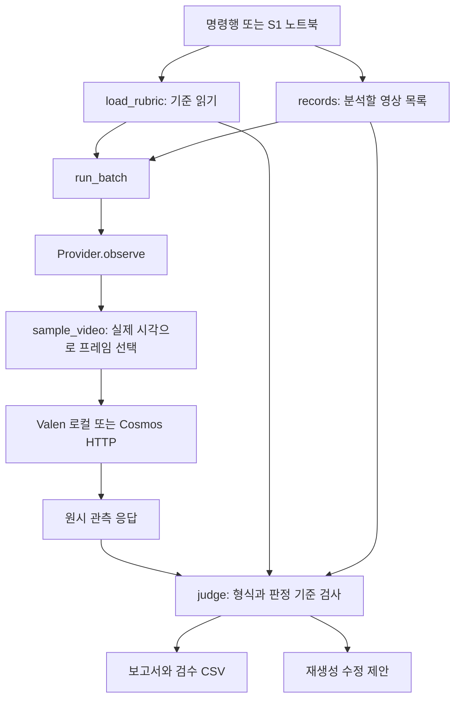
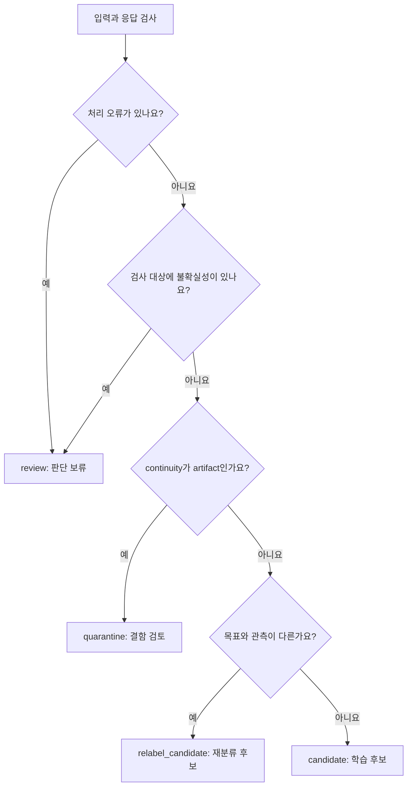
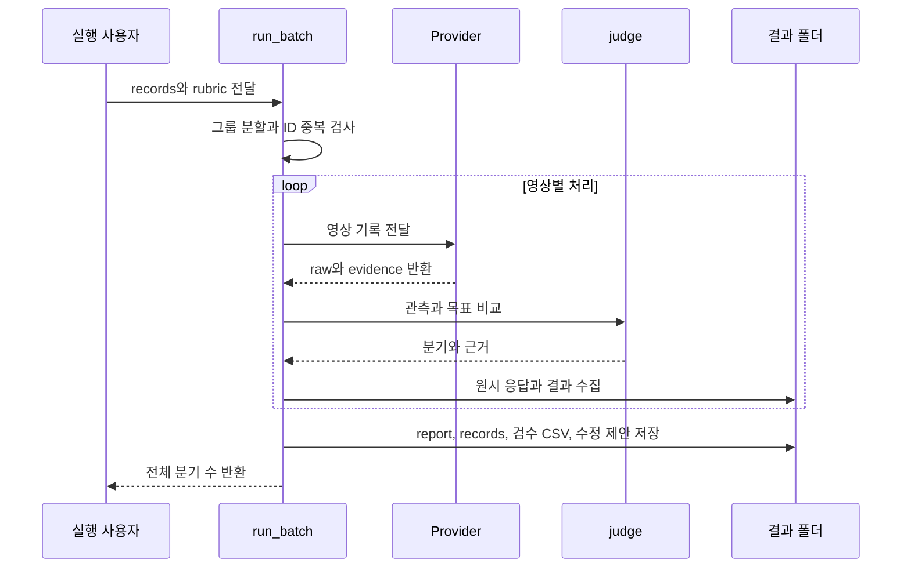

# 기술 구조 설명서: 설정에서 검수 보고서까지

[문서 모음](README.md) · [이론](THEORY.md) · [다음: 조건 작성](CRITERIA_AUTHORING.md)

이 문서는 현재 `Decision` 코드가 실제로 하는 일을 기준으로 설명합니다. 확률 보정, 모델 학습, 물리 검증처럼 아직 구현하지 않은 기능은 현재 기능과 구분해서 표시합니다.

## 1. 전체 구성



CPU 예제의 `FixtureProvider`는 위 그림의 프레임 추출과 모델 호출을 생략하고 미리 만든 응답을 반환합니다. 실제 영상을 이해한 결과처럼 표시하지 않도록 provider 정보에 `real_inference=false`가 들어갑니다.

| 구성 요소 | 코드 | 맡는 일 |
|---|---|---|
| 명령행 | [semantic_cli.py](../../src/av_decision/semantic_cli.py) | 옵션을 읽고 같은 공통 함수를 호출합니다. |
| 기준과 판정 | [semantic.py](../../src/av_decision/semantic.py) | 설정·응답·입력 검증, 분기, 검수 파일, 평가를 처리합니다. |
| 모델 연결 | [semantic_providers.py](../../src/av_decision/semantic_providers.py) | 영상 샘플링과 Valen 로컬·VLM HTTP 연결을 제공합니다. Cosmos HTTP는 기존 이름을 유지합니다. |
| 모델 선택 | [provider_factory.py](../../src/av_decision/provider_factory.py) | CLI·노트북이 공유하는 JSON 설정 검사, 연결 객체 생성, 공통 계약을 제공합니다. |
| 기본 설정 | [criteria.ko.json](../../src/av_decision/configs/criteria.ko.json) | 질문, 선택지, 임계값, 목표 매핑, 수정 제안을 정의합니다. |
| 실습 | [S1 노트북](../../notebooks/S1_Semantic_Video_Verification.ipynb) | 설명과 실행 셀을 제공하며 판정 로직을 복제하지 않습니다. |

## 2. 입력 목록은 모델 요청과 다릅니다

`records.json`은 분석 작업의 메타데이터입니다. 모델에게 이 객체를 통째로 전달하지 않습니다.

```json
{
  "clip_id": "drive-a-clip-01",
  "video_path": "/data/clips/clip-01.mp4",
  "source_group": "drive-a",
  "split": "train",
  "target": {"weather": "rain", "cut_in": "yes"},
  "target_needs_review": false,
  "source_observation_hz": null,
  "window": {"start_s": 0.0, "end_s": 5.0},
  "attempt": 1
}
```

이 JSON은 형식 예시이며 실제 파일 경로와 관측 주기는 따로 확인해야 합니다. `source_observation_hz=null`이면 현재 기본 규칙의 시간 관련 판정은 보류됩니다.

| 정보 | 모델에 전달하나요? | 사용 위치 |
|---|---|---|
| 실제 추출 이미지와 상대 시각 | 예 | 시각·시간적 관측 입력입니다. |
| 공통 관측 지시문과 질문·선택지 | 예 | 어떤 기준으로 관측할지 정합니다. |
| 생성 목표 `target` | 아니요 | 관측 후 규칙에서 비교합니다. |
| 원래 파일명·생성 프롬프트 | 아니요 | 출처를 기록하는 데만 사용합니다. |
| 원본 그룹·분할·생성 횟수 | 아니요 | 데이터 누수 검사와 재생성 제안에 사용합니다. |
| 사람이 작성한 정답 | 아니요 | 모델 결과 평가에 사용합니다. |

Valen에는 새로 추출한 `frame-0000.jpg` 같은 경로가 전달됩니다. 이는 원본 생성 파일명을 프롬프트에 넣는 것과 다릅니다. Cosmos에는 이미지 바이트를 base64로 변환해서 보냅니다.

## 3. 질문을 모델에 전달하는 계약

`questions_for_model()`은 모든 영상에 같은 질문 집합을 만듭니다. 질문마다 다음 구조가 전달됩니다.

```json
{
  "type": "choice",
  "instructions": "보행자가 도로를 가로질러 이동하는 전후 과정이 보이나요?",
  "criteria": {
    "yes": "횡단하는 과정이 관측됩니다.",
    "no": "필요한 구간이 보이며 횡단은 관측되지 않습니다.",
    "unknown": "가림이나 짧은 구간 때문에 판단할 수 없습니다."
  }
}
```

기준 파일의 `title`과 `temporal`은 모델 요청에 그대로 들어가지 않습니다. `title`은 읽기 쉬운 이름이고, `temporal`은 소프트웨어가 시간 근거를 검사할 때 사용합니다. 모델에게 시간 전후를 확인하게 하려면 질문의 `instructions`에도 그 의미를 적어야 합니다.

Valen의 메시지·선택형 질문 계약은 공식 입력 형식을 따릅니다. 다만 이 프로젝트는 네이티브 비디오 대신 시간순 이미지 입력을 사용합니다. [공식 입력 형식](https://github.com/Liuziyu77/Valen/blob/main/docs/data-format.md)

## 4. 프레임 선택과 시간 검사

`sample_video()`는 PyAV로 읽은 실제 PTS를 첫 프레임 기준 초 단위로 바꿉니다. 분석 구간은 시작을 포함하고 끝을 제외합니다. 기본 설정은 4fps 요청, 최대 8초, 최대 32장입니다.

1. 파일·구간·설정을 확인합니다.
2. 실제 프레임 시각이 누락·중복·역전되지 않는지 확인합니다.
3. 다음 요청 시각에 도달한 실제 프레임을 고릅니다. 없는 프레임을 보간하거나 복제하지 않습니다.
4. 비율을 유지하여 960×540 경계 안으로 줄이고 JPEG로 저장합니다.
5. 선택 시각, 구간 양끝의 공백, 영상 해시를 기록합니다.

요청이 4fps여도 원본 시각 때문에 0.0, 0.3, 0.5, 0.8초를 고를 수 있습니다. 이때 실제 최대 공백은 0.3초입니다. 원본이 더 성긴 경우 같은 이미지를 복제해서 빈 구간을 채우지 않습니다.

| 제한 | 동작 |
|---|---|
| 영상이 너무 길거나 구간이 범위를 벗어남 | 오류를 기록하고 해당 영상을 검수 대상으로 남깁니다. |
| 최대 프레임 수 초과 | 입력을 조용히 줄이지 않고 오류를 냅니다. |
| 프레임이 두 장 미만 | 시간 변화를 비교하기 어렵다고 보고 오류를 냅니다. |
| 원본 관측 주기 미확인 | 모델을 호출할 수 있어도 시간 관련 자동 분기는 보류합니다. |

`continuity`는 항상 확인하는 시간 관련 기준입니다. 따라서 `target`에 날씨만 넣었더라도 원본 관측 주기가 없으면 현재 규칙상 자동 후보가 되지 않습니다. 정지 장면 조건만 검사하는 별도 모드가 필요하다면 판정 정책을 추가 구현해야 합니다.

## 5. 응답 정규화

`normalize_answers()`는 모든 질문 ID가 정확히 들어왔는지 검사합니다. 추가한 질문이 하나라도 빠지거나 등록하지 않은 답이 오면 오류입니다.

```json
{
  "answers": {
    "cut_in": {
      "choice": "yes",
      "probabilities": {"yes": 0.82, "no": 0.12, "unknown": 0.06}
    }
  }
}
```

위 예시는 한 질문만 보여 준 것입니다. 실제 응답에는 기준 파일의 모든 질문이 있어야 합니다. 선택지별 확률은 유한한 0~1 값이어야 하며 전체 선택지를 포함하고 합이 1이어야 합니다. 선택한 답은 최대 확률 선택지여야 합니다.

선택한 답의 확률과 1·2위 차이는 소프트웨어가 다시 계산합니다. 확률이 없으면 `None`으로 남깁니다. Cosmos 어댑터는 자유 생성된 확신도를 사용하지 않으므로 확률을 항상 `None`으로 보냅니다.

## 6. 실제 분기 순서



검사 대상은 `target`, 분류 설정의 `scene_criteria`, 공통 품질 질문의 합집합입니다. 공통 품질 질문은 영상에서 `continuity`, `visibility`, 정지 이미지에서 `visibility`입니다. 정지 이미지의 시간 질문은 `unknown`으로 처리합니다. `observed`에는 전체 질문의 답이 있어도 모든 라벨이 검수된 것은 아닙니다. 이번 분기에 실제로 사용한 질문은 `checked_criteria`에 기록합니다.

불확실성은 `unknown`, 확률 없음, 낮은 확률 또는 점수 차이, 시간 근거 부족을 뜻합니다. 결함이 관측되어도 불확실성이 함께 있으면 먼저 `review`가 됩니다. 결함 선택지는 `observed`에 남습니다.

모든 분기에 `requires_human_approval=true`를 기록합니다. 이 필드는 승인 시스템을 실행하는 기능이 아니라 아직 사람 확인이 필요하다는 상태 표시입니다.

## 7. 파일별 데이터 흐름



| 산출물 | 주로 읽는 사람·프로그램 | 포함하는 내용 |
|---|---|---|
| `records.json` | 실험 재현 담당자 | 입력 기록의 복사본 |
| `raw-xxxx.json` | 모델 연결 디버깅 담당자 | 정규화 전에 JSON으로 저장한 응답. 호출 실패나 JSON으로 저장할 수 없는 응답은 없을 수 있음 |
| `evidence-xxxx/sampling.json` | 검수자 | 프레임 시각·분석 구간·영상 해시 |
| `report.json` | 스터디 참가자·평가 코드 | 관측·목표·분기·이유·기준·모델 정보 |
| `human_review.csv` | 검수자 | 모델 답, 비어 있는 사람 정답 칸, 오류 |
| `regeneration_plans.json` | 생성 조건 검토 담당자 | 수정 제안, 같은 원본 그룹, 다음 생성 횟수 |

프로세스 종료나 디스크 장애까지 복구하는 트랜잭션 저장소는 아닙니다. 정상적으로 완료된 배치에서는 전체 보고서가 저장되며, 중간 파일만 남은 경우 완료 결과와 구분해야 합니다.

## 8. 실패를 다루는 두 범위

| 범위 | 예 | 동작 |
|---|---|---|
| 배치 전체 입력 문제 | 같은 원본 그룹의 분할 충돌, ID 중복, 이미 있는 출력 폴더 | 배치를 시작하지 않고 오류를 냅니다. |
| 영상 하나의 처리 문제 | 잘못된 목표, 파일 디코딩 실패, 모델 응답 형식 오류 | 해당 영상을 `review`와 오류 정보로 남기고 다음 항목으로 넘어갑니다. |

명령행에서는 영상별 실패가 한 개라도 있으면 보고서를 저장한 뒤 종료 코드 2를 반환합니다. Notebook의 `run_batch()`는 보고서를 반환하므로 `error` 필드도 확인해야 합니다. 오류 응답의 원문 저장 여부는 실패 지점에 따라 다르며, 모든 실패 응답을 별도 파일로 보존하는 기능은 아닙니다.

## 9. 재생성 제안의 조건

다음 세 조건을 모두 만족하면 `ready_for_generation=true`가 됩니다.

- 결과가 `relabel_candidate`입니다.
- `attempt`가 `max_attempts`보다 작습니다.
- 분할이 `train` 또는 `validation`입니다.

총 2회가 기본값이며 최초 생성을 포함합니다. 코드는 생성 서버를 호출하지 않습니다. 수정 제안을 반영한 다음 결과에서는 `clip_id`를 새로 만들고 `attempt`를 올리며 그룹과 분할을 유지합니다.

`repair_hints`가 없는 질문은 수정 문장이 생성되지 않습니다. 이 경우에도 현재 함수는 위 세 조건만으로 준비 상태를 정할 수 있으므로, 새 기준에는 대응하는 수정 제안도 적고 `corrections`가 비어 있지 않은지 확인하세요.

## 10. 변경 종류별 영향 범위

| 변경 | 설정만 바꿔도 되나요? | 추가로 확인할 부분 |
|---|---|---|
| 기존 질문의 문장 수정 | 예 | 점수와 해석이 달라질 수 있으므로 재평가합니다. |
| 기존 선택지 설명 수정 | 예 | 같은 ID라도 의미가 바뀌면 이전 라벨과 비교에 주의합니다. |
| 새 질문 추가 | 기본 관측 경로는 가능 | 모델은 전체 질문에 답해야 하며 예제 Fixture도 보완해야 합니다. |
| 질문을 통과 조건으로 사용 | `target`에 추가 | 등록만 해서는 자동 분기에 포함되지 않습니다. |
| 조건마다 다른 임계값 | 아니요 | 현재는 공통 임계값이므로 `judge()` 확장이 필요합니다. |
| “비 또는 눈” 같은 OR 목표 | 아니요 | 현재 목표는 질문별 단일 값의 일치를 확인합니다. |
| 공통 품질 질문 삭제·이름 변경 | 아니요 | 현재 함수가 두 ID를 직접 참조합니다. |
| 음성 질문 추가 | 아니요 | 오디오 입력·모델 어댑터·시간 정렬부터 필요합니다. |
| 영상 픽셀 편집·자동 재생성 | 아니요 | 현재 출력은 라벨과 수정 제안입니다. |

다음 [판별 조건 작성 안내](CRITERIA_AUTHORING.md)에서는 가능한 설정 변경부터 실제 예제로 진행합니다.
