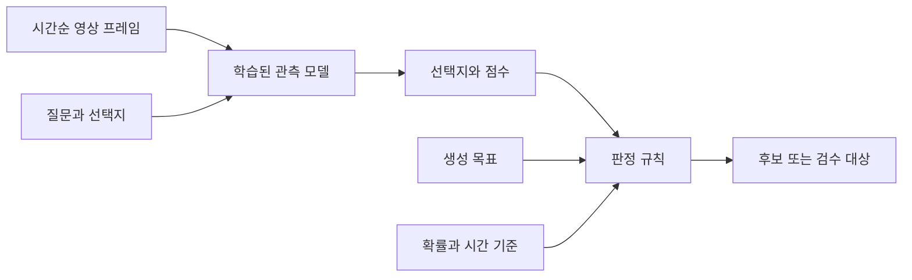
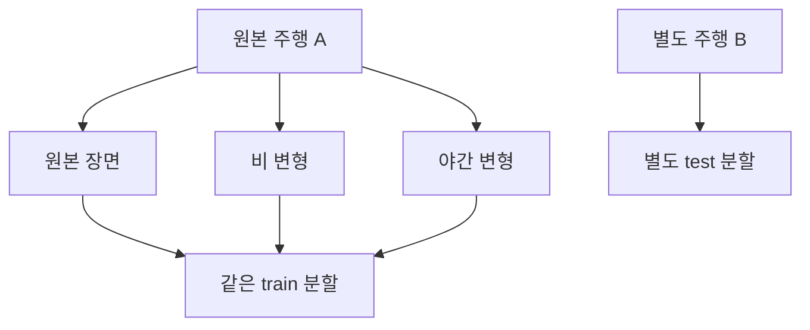

# 이론 설명서: 영상의 의미를 판단한다는 것

[문서 모음](README.md) · [다음: 기술 구조](TECHNICAL_DESIGN.md)

이 문서의 목표는 코드를 외우는 것이 아니라, 어떤 질문을 어떤 근거로 판정하는지 이해하는 것입니다. “작고 빠르게 결론을 내리는 모델”이 유용하려면 먼저 결론의 의미와 판단 불가의 범위를 정해야 합니다.

## 1. 생성 목표는 관측된 사실이 아닙니다

“비 오는 밤에 옆 차로 차량이 끼어드는 영상”을 요청했다고 생각해 보겠습니다. 실제 결과에는 야간 조명과 젖은 도로만 있고, 차량이 차선 경계를 넘는 과정이 없을 수도 있습니다.

| 정보 | 예 | 역할 |
|---|---|---|
| 생성 목표 | 비, 야간, 끼어들기 있음 | 만들고 싶었던 장면입니다. |
| 영상 관측 | 야간은 보임, 비는 불명확, 끼어들기는 없음 | 모델 또는 사람이 실제 자료에서 확인한 내용입니다. |
| 검수 정답 | 두 사람이 영상을 보고 합의한 라벨 | 모델의 판단을 평가할 기준입니다. |
| 처리 결과 | 판단 보류 | 다음에 무엇을 해야 하는지 정하는 소프트웨어 규칙입니다. |

이 네 가지를 한 필드에 섞으면, 생성 프롬프트가 곧 정답이 되는 문제가 생깁니다. 이 프로젝트는 목표를 `target`, 관측을 `observed`, 사람 정답을 `human_choice`, 처리 결과를 `disposition`으로 나눕니다.


## 2. Decision 모델과 규칙은 무엇이 다른가요?

Decision 모델은 입력과 질문을 보고 정해진 선택지의 점수를 만드는 학습된 모델입니다. 규칙은 그 결과를 받아 “어떤 경우에 보류할 것인가?”처럼 사람이 정한 정책을 실행합니다.



그림에서 모델은 장면을 관측하고, 규칙은 처리 방향을 결정합니다. 규칙만으로 영상 내용을 알아낼 수는 없습니다. 반대로 영상 모델의 높은 점수만으로 모든 자료를 통과시킬 필요도 없습니다.

| 방식 | 출력 | 이 프로젝트에서의 쓰임 |
|---|---|---|
| 자유 생성 VLM | 장면 설명 문장 또는 JSON | Cosmos 서버가 선택지 이름을 작성합니다. 확률은 사용하지 않습니다. |
| 선택형 Decision 모델 | 정해진 선택지와 선택지별 점수 | Valen 어댑터가 관측 후보를 만듭니다. |
| 결정 규칙 | `candidate`, `review` 등 | `judge()`가 목표·점수·시간 근거를 비교합니다. |
| Fixture | 사람이 미리 만든 가상 관측 | GPU 없이 처리 규칙을 배웁니다. 영상 인식 모델이 아닙니다. |

Valen의 공식 모델 카드는 Qwen3.5와 결정 헤드의 조합, 여러 질문이 입력 표현을 공유하는 `shared_state` 실행을 설명합니다. 현재 어댑터도 이 호출 방식을 사용합니다. 이 구조가 이 프로젝트의 한국어 자율주행 기준에서 어느 정도 효과적인지는 별도로 측정해야 합니다. [Valen 공식 모델 카드](https://huggingface.co/Valen-Team/Valen-2B)

## 3. 왜 빠를 수 있고, 왜 여전히 비용이 드나요?

선택형 모델은 긴 설명 문장을 토큰 하나씩 생성하는 부담을 줄일 수 있습니다. 여러 질문이 같은 영상 표현을 공유하면 반복되는 입력 처리를 줄일 여지도 있습니다. 다만 영상 디코딩과 이미지 인코딩까지 없어지는 것은 아닙니다.

개념적으로 한 영상의 전체 시간은 다음 항목을 합쳐 생각할 수 있습니다. 이는 실제 프로파일링 수식이 아니라 병목을 나눠 보는 방법입니다.

```text
전체 처리 시간 ≈ 영상 읽기 + 프레임 추출 + 이미지 처리 + 모델 판정 + 결과 저장
첫 실행 시간   ≈ 위 시간 + 모델 로딩과 초기화
```

같은 모델도 프레임 수·해상도·질문 수·GPU·정밀도에 따라 속도와 메모리가 달라집니다. 출력이 짧다는 이유만으로 실시간 처리가 된다고 결론 내리면 안 됩니다. `report.json`의 `elapsed_s`에는 첫 모델 로딩과 전처리가 섞이므로 순수 추론 지연시간으로 비교하지 않습니다.

작은 모델의 장점은 실제 자료에서 **정확도, 보류율, 처리량, 메모리**를 함께 측정해서 판단합니다. 이 저장소에는 GPU 속도 비교 실험 결과가 아직 없습니다.

## 4. 선택지 확률과 실제 정확도는 다릅니다

예를 들어 끼어들기 질문에 다음 점수가 나왔다고 해 보겠습니다. 아래 숫자는 설명용입니다.

| 선택지 | 점수 |
|---|---:|
| `yes` | 0.82 |
| `no` | 0.12 |
| `unknown` | 0.06 |

가장 큰 점수를 가진 선택지는 `yes`이고, 1위와 2위의 차이는 `0.82 - 0.12 = 0.70`입니다. 현재 코드는 선택한 답의 확률을 `confidence`, 두 점수의 차이를 `margin`으로 기록합니다. 이 `confidence`는 Valen 원본 응답의 같은 이름 필드와 계산 정의가 다를 수 있으므로 원본과 구분합니다.

소프트맥스는 모델의 점수들을 합이 1인 값으로 바꿉니다. 하지만 **합이 1이라는 성질과 실제로 맞는 빈도는 별개**입니다. 0.9라고 답한 영상 100개 중 실제로 90개가 맞는지 확인하는 것이 확률 보정의 관점입니다. 신경망 점수와 실제 정확도의 차이는 확률 보정 연구에서도 다룹니다. [Guo 등의 확률 보정 연구](https://proceedings.mlr.press/v70/guo17a.html)

기본값 0.80은 검증된 안전 기준이 아닙니다. validation 자료의 사람 정답과 비교해서 정해야 합니다. 현재 구현에는 온도 보정이나 조건별 자동 임계값 최적화가 없습니다.

### 1위 확률과 점수 차이를 함께 보는 이유

`yes=0.51`, `no=0.48`, `unknown=0.01`이면 답은 `yes`지만 두 선택지가 거의 비슷합니다. `margin`은 이런 경합을 표현합니다. 다만 두 값은 독립적인 근거가 아닙니다. 합이 1인 분포에서 1위 확률이 0.80 이상이면 2위는 최대 0.20이므로 차이는 최소 0.60입니다.

따라서 **기본값인 확률 0.80·차이 0.20 조합에서는 차이 조건이 추가로 거르는 사례가 없습니다.** 확률 기준을 낮추거나 차이 기준을 크게 바꾸면 효과가 나타날 수 있습니다. 두 임계값이 서로 다른 신뢰 증거를 제공한다고 해석하지 마세요.

## 5. 판단을 보류하는 것은 어떤 의미인가요?

현재 코드는 다음 경우를 보류합니다.

- 선택지가 `unknown`입니다.
- 비교에 사용할 확률이 없거나 점수가 기준에 못 미칩니다.
- 시간 사건인데 프레임 간격이나 원본 관측 주기의 근거가 부족합니다.
- 모델 응답이나 영상 처리에 오류가 있습니다.

“모델이 모른다”와 “사건이 없다”를 구분하는 것이 중요합니다. 보행자가 차 뒤에 가려졌다면 횡단이 없었다고 확정할 수 없습니다. `no`를 정답으로 쓰면 모델에 잘못된 음성 사례를 가르칠 수 있습니다.

또한 `review`는 모델의 선택지가 아닙니다. `yes`라고 답했어도 점수가 낮거나 시간 정보가 부족하면 소프트웨어가 `review`로 분류합니다. Cosmos처럼 검증 가능한 선택지 확률을 사용하지 않는 경로도 기본적으로 검수 대상으로 남습니다.

## 6. 영상에서는 시간 정보가 왜 중요한가요?

정지 화면은 물체의 존재를 보여 줄 수 있지만, 차선 경계를 넘는 과정이나 간격 변화는 전후 관계가 필요합니다. 프레임 순서뿐 아니라 언제 관측했는지, 중간에 얼마나 큰 공백이 있었는지가 중요합니다.


그림의 10fps 행은 새 관측을 추가한 것이 아니라 기존 관측을 반복 저장한 예입니다. 반복된 이미지는 부드러운 재생 형식을 만들 수 있지만, 그 사이에 실제로 무슨 일이 있었는지는 알려 주지 않습니다.

- `sample_fps`: 분석을 위해 초당 몇 장을 요청할지 정합니다.
- `max_gap_s`: 실제로 고른 프레임과 구간 양끝에서 가장 긴 공백입니다.
- `source_observation_hz`: 원본에 확인 가능한 독립 관측이 얼마나 자주 있었는지 기록합니다.

기본 설정의 4fps·0.30초도 교육용 시작점입니다. 사건이 빠르다면 필요한 관측 해상도가 더 높을 수 있습니다. 생성된 중간 움직임이 자연스럽더라도 그것을 원본 사건의 실제 관측으로 취급하지 않습니다.

## 7. 어려운 장면과 잘못 만들어진 장면은 다릅니다

안개, 야간, 일부 가림은 자율주행 데이터에서 필요한 조건입니다. 이런 장면을 모두 버리면 쉬운 자료만 남습니다. 반면 가림 없이 차량이 사라지거나 도로가 심하게 변형되는 현상은 생성 결함의 후보입니다.

`visibility=limited`는 어려운 장면이라는 표시이며 자동 폐기 조건이 아닙니다. `continuity=artifact`는 생성 결함의 관측이고, 다른 불확실성이 없다면 별도 검토 상태로 분류합니다. 어느 쪽도 실제 파일을 삭제하지 않습니다.

시각적으로 잘 만들어진 영상과 물리적으로 맞는 영상도 구분해야 합니다. 단안 영상의 상대 크기 변화만으로 실제 거리, 감속도, 충돌 시간을 정확히 알 수 있는 것은 아닙니다. 특히 `gap_closing=yes`를 `near_collision`의 정답으로 바꾸면 주장하는 의미가 달라집니다.

## 8. 좋은 평가에는 어떤 분모가 필요한가요?

아래 수는 설명을 위한 가상 예입니다. 실제 양성 10개에 대해 `yes` 6개, `no` 1개, `unknown` 2개, 처리 실패 1개가 나왔다고 해 보겠습니다.

| 항목 | 수 | 해석 |
|---|---:|---|
| 양성 정답을 `yes`로 답함 | 6 | 맞게 찾았습니다. |
| 양성 정답을 `no`로 답함 | 1 | 현재 함수의 미탐 수입니다. |
| 양성 정답에서 판단 불가 또는 실패 | 3 | 현재 함수의 `unknown_on_positive`입니다. |

현재 함수의 미탐률은 `1/10=10%`입니다. 이 숫자만 보면 놓치는 사례가 적어 보이지만, 실제로 양성을 확인하지 못한 자료는 `1+3=4개`입니다. 판단 불가와 실패를 함께 보고해야 하는 이유입니다.

“보류하지 않은 자료 중 정확도”도 유용하지만, 보류율을 같이 적어야 합니다. 현재 `evaluate_human_labels()`는 입력된 정답 행 기준의 정확도와 이진 사건 통계를 계산하며, 보류 제외 정확도를 따로 제공하지는 않습니다. 다른 평가 정의가 필요하면 분모를 명시하고 별도로 계산하세요.

## 9. 데이터 누수는 왜 점수를 부풀리나요?



원본과 날씨만 바꾼 파생 영상이 train과 test에 나뉘면, 모델이 이미 본 도로·차량·배치를 이용할 수 있습니다. 새 환경을 잘 처리하는지 평가하려던 의도와 달라집니다. 그래서 같은 원본 그룹은 같은 분할에 둡니다.

현재 코드는 한 배치의 `source_group` 분할 충돌을 검사합니다. 다른 실행 폴더까지 자동으로 비교하지는 않습니다. 전체 자료 관리에서도 원본 그룹을 유지해야 합니다.

## 10. 재생성은 어떤 학습 효과를 기대하나요?

재분류는 자료의 의미를 더 정확하게 만드는 단계입니다. 실제로 도움이 되는지 보려면 다음을 구분해서 비교해야 합니다.

1. 생성 목표를 그대로 라벨로 사용한 집합
2. 관측을 통해 재분류하고 사람이 검수한 집합
3. 같은 검수 기준을 적용하되 어려운 장면도 보존한 집합

학습 모델, 원본 분할, 평가 환경을 고정한 상태에서 비교해야 라벨 정리의 효과를 해석하기 쉽습니다. 필터링한 집합만 더 쉬워져 정확도가 올라간 것인지도 확인하세요.

이 프로젝트는 위 실험을 위한 라벨·검수 근거를 준비합니다. 모델 학습이나 정책의 폐루프 평가까지 자동 수행하는 코드는 포함하지 않습니다.

## 용어를 다시 확인하기

| 용어 | 이 프로젝트에서의 뜻 |
|---|---|
| 판별 기준, rubric | 질문·선택지·임계값·매핑을 담은 JSON 설정 |
| 관측, observation | 모델이 입력에서 확인했다고 답한 내용 |
| 정답, human label | 사람이 실제 자료를 보고 작성한 평가 기준 |
| 임계값, threshold | 어느 경우에 자동 분기를 허용할지 정하는 수치 |
| 원본 그룹, source group | 원본 주행과 그 변형들을 묶는 식별자 |
| 보정, calibration | 모델 점수와 실제 맞는 빈도를 맞추거나 점검하는 과정 |
| 분포 변화 | 학습·검증 때와 다른 날씨, 도로, 센서, 언어 표현 등이 들어오는 상황 |

다음으로 [기술 구조 설명서](TECHNICAL_DESIGN.md)에서 이 개념이 코드의 어느 함수와 필드에 연결되는지 확인하세요.
